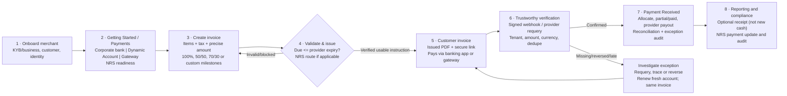

# OCTALVE FINANCE — DYNAMIC COLLECTION, GETTING STARTED, NRS AND COMPLETE USER JOURNEY

**Owner clarification:** 17 October 2026. **Status:** Owner decisions + design/implementation PROPOSALS. **Scope:** EXISTING `octalve-core/octalve-invoice` Phase 0I; **no Phase 1, production, banking or NRS activation authorized**.
**References:** `DECISIONS.md`, `INVOICE_RECEIPT_PAYMENT_AUTHORITY.md`, `NUMBERING_AND_CREDIT_AUTHORITY.md`, `PAYMENTS_ARCHITECTURE.md`, `FINANCIAL_EXCEPTION_LIFECYCLE.md`, `FINANCIAL_METRICS_AND_EVENT_AUTHORITY.md`, `DATA_MODEL.md`, 17 Oct owner client/merchant invoice illustrations and four-screen Getting Started/payment-gateway examples. All referenced screenshots are **layout/interaction examples**, not authentic financial data, approved logo replacements or API-connected credentials.

## A. New explicit owner clarifications that bind further UI design
1. Owner's 70/30 example is **not an instalment-plan limit**. Preserve already-developed 100%, 50/50, 70/30, arbitrary percentages, fixed amounts and custom milestones/instalment dates. A provider single-use account MAY NOT accept repeated partial transfers; create provider-qualified, individually referenced collection intents per amount or milestone. Keep existing invoice editor/renderer architecture and shared preview state.
2. Illustrative names, seller/buyer contacts, bank payees, invoice numbers and figures in screenshots must **not** overwrite correct authoritative merchant issuer/buyer snapshots, true payment beneficiary, original logo, or number series `[MERCHANT_INITIALS]-[SEQUENCE][TYPE]`, e.g. `OL-00001INV`, `WE-00001INV`. Approved codes INV/RP/QUO/CR/EXP/SF intact; provisional CUS/ITM remains unapproved.
3. The screenshots' **Flex Account** is the desired **Dynamic Account / Invoice-specific Virtual Account** option. Clarify concept consistently in Getting Started > Payments, connected provider capabilities, composer and invoice details. This is an account issued by a contracted, connected provider for collection; not an independent merchant settlement/corporate bank account.
4. For a dynamic account, the **invoice/milestone due timestamp must be <= confirmed provider account expiry timestamp**. Prefer equal due/expiry when provider can genuinely honour it. Never offer a later selectable date; never silently truncate requested validity; validate before save/issue and validate the actual provider response at issue time.
5. Customer and merchant see two intentionally different representations of **one** underlying invoice/payment state. The screenshot layout is a template/experience reference. Customer options: authorised PDF/print and transfer/pay now/check-payment. Merchant: reminders, status verification, controlled manual bank-cleared evidence only for eligible bank-transfer invoices, exceptions, secure copy link and NRS state. No client “I have paid” button changes settlement authority.

## B. Collection option vocabulary and Getting Started product flow
Canonical four-stage Getting Started from existing application: `Business → Invoices → Payments → Tools`. Make Payment step an expandable choice/connection dashboard:
- **Company Bank Transfer**: merchant chooses a supported current bank, enters NUBAN, receives genuine server-side bank name enquiry and merchant ownership confirmation in Phase 1, then uses it in eligible invoice instructions. Today UI suggestions are curated only, not bank verification; do NOT display unverified bank instructions as verified.
- **Dynamic Account** (formerly Flex Account): choose connected Monnify, eligible Flutterwave version, or future bank/regulated provider; capability/fee/maximum validity and current connection status appear before selection. Connection is tenant-merchant-owned. No provider-owned API key exposed after secure entry. A payment request is generated for each approved invoice/milestone and its verified expiry is displayed.
- **Online Gateway**: merchant-connected Paystack/Flutterwave/Monnify checkout link, signature and backend verification; provider checkout is optional for clients, never required for dynamic account transfer.
- **Future Partner Bank Collection**: disabled “Partnership planned” capability until real agreement, verified API, account-issuance authority and settlement/reconciliation controls. Bank-issued *virtual collection subaccounts or identifiers* must not be inaccurately called new independent legal corporate settlement accounts for every invoice.
- Wallet/PayPal or regional channels depicted in donor screenshots do not become supported or active merely by visual reference. No invented gateway connection state, online payment provider eligibility or NRS accreditation.

Connection states proposed: `NOT_CONNECTED → DETAILS_SUBMITTED → PROVIDER_VERIFIED → ENABLED`, with `SUSPENDED, REVOKED, EXPIRED, NEEDS_ACTION`. Storing credentials requires authenticated server operation, tenant-scoped permissions, MFA/step-up, encrypted vault/KMS, CSRF/Origin guard, secret rotation, provider account capability checks, webhook endpoint arrangement and secure audit; NONE is implemented in Phase 0I. Provider-specific credential forms must come from verified chosen API, not blindly copying all fields from screenshots.

## C. Provider expiry matrix — official published public docs reviewed 17 October 2026
| Provider PRODUCT | Documented capability | UI eligibility policy / open verification |
| --- | --- | --- |
| Monnify **Create Invoice / Dynamic Invoice** | One unique single-use account per invoice; request accepts `expiryDate`; account closes after payment; maximum permitted lifetime not reliably published in read official guide. | **First sandbox candidate**, expiry range must be confirmed with provider and actual contract/API response. Do not confuse with Monnify checkout **40-minute Pay With Transfer**. |
| Flutterwave **v3 NGN Dynamic Virtual Account** | `expires` in seconds, published max 5,270,401 seconds (~2 months). | Allow due timestamp only within exact eligible duration; confirm merchant enablement and returned `expiry_date`. |
| Flutterwave **v4 Dynamic Account** | Published max 31,536,000 seconds (365 days), default 1 hour; version-specific API and customer/merchant eligibility. | **Longer-term candidate**, do not assume v3/v4 keys or response formats interchangeable; verify live capability in sandbox. |
| Paystack **Pay with Transfer** | `account_expires_at` valid 15 minutes–8 hours, out-of-range coerced by provider. | Do not use as default for multi-day PDF invoices; keep checkout or short time-bound transfer with true expiry only. |
| Future partner bank | Unspecified until contract and technical testing. | Show **unavailable**; do not promise unlimited, self-issued corporate accounts or settlement rights. |

Official sources:
- https://developers.monnify.com/docs/collections/one-time-payments/invoice
- https://developers.monnify.com/docs/collections/payment-methods
- https://support.monnify.com/topics/integrating-monnify-244
- https://developer.flutterwave.com/reference/create-a-virtual-account-number-1
- https://developer.flutterwave.com/v4.0.0/docs/pay-with-bank-transfer
- https://paystack.com/docs/payments/payment-channels/

Providers determine final expiry and merchant capabilities. Do not calculate a legal/contractual max from an example screenshot. Store provider version, merchant connection, actual UTC expiry and Nigerian local display time with timezone. Require `invoiceDueAt <= providerExpiresAt` upon confirmed issuance. For user-entered future due dates, upper-bound from *expected creation time* is provisional; server must re-check at provider response. On failure: block issuance, show precise reason and alternative, never silently shorten expiry, substitute bank, fabricate virtual account, or issue a contradictory PDF.

**Date-time example:** invoice due 2026-10-31 23:59:59 Africa/Lagos; provider account expiry must be >= that instant. “31 October” alone does not ensure validity until end of day; ensure provider API timezone semantics and DST where relevant. Single-use accounts typically close immediately after accepted payment, even before scheduled expiry. Earlier closure is not an error once confirmed paid.

## D. Formal payment schedule preservation
- Invoice contractual face value is one immutable claim; milestone/instalment plans are scheduled obligations **not separate issued invoices** unless specifically authorized.
- Presets (100%, 50/50, 70/30) and custom percentages or exact NGN amounts; computed sum must exactly equal eligible total, allocating minor-unit rounding residual to final instalment under explicit policy.
- Every due milestone may have own `CollectionIntent`, independently configured amount, provider, expiry and status. Create remaining-balance payment intent only if selected provider supports it.
- If total invoice ₦180,000 with 70/30, actual scheduled collections are ₦126,000 and ₦54,000 (illustrative); verified first ₦126,000 results in `PARTIAL` with remaining ₦54,000, not “Paid”. A 50% plan, custom 25/25/50 or date-triggered milestones must work similarly. VAT/tax treatment remains tied to approved invoice tax rules, not multiplied across receipt documents.
- Provider under/over-pay rules override UI wishful thinking; underpaid provider transfers may be automatically reversed. Overpaid accepted amounts go to unapplied funds/refund/credit exception without inventing extra earned revenue.
- Auto receipt OFF by default; optional `GENERATE` and `GENERATE_AND_EMAIL` only for verified online payment under already-approved setting, never receipt-as-new-cash.

## E. Invoice lifecycle and two-view template contract
`DRAFT (watermarked, no export)` → merchant review → validate merchant/customer/items/amount/tax/due/connection → obtain authentic account when dynamic → verify expiry and securely persist → allocate number/snapshot at server-controlled issue → applicable NRS validation/fiscal flow → deliver via authorized channel; NRS applicability determines whether delivery must await validation. Preserve historic issued PDF hash and merchant branding. The authorized client view shows invoice details, status and **currently valid** payment instructions. Merchant view shows management actions and payment/NRS states; both derive from one backend.
- Customer gateway: Download/Print when duly issued; Pay Now via provider. Dynamic: Download/Print, Copy account, Check Payment (not “I have paid” as proof), expiry timestamp and amount. Company-bank: merchant verified business bank instructions, optional customer enquiry.
- Merchant: Send Reminder, Check Provider Status, Copy Link, Payment Received and Investigate; **Record Cleared Payment** only for eligible independent company bank transfer after genuine evidence/approval. Distinct Revalidate NRS action where applicable. No manual mark-paid on provider-controlled payment.
- Screenshots showing logo/name/contact/bank/IRN/QR are examples. Fiscal QR/IRN only official NRS records; a merchant payment QR must be clearly separate. No unapproved product-provider logo fabrication, no auto-readjusted legacy snapshots.

## F. Expired-account policy — RECOMMENDED, requires provider qualification
1. Prior to expiry: show “valid until” on client PDF/secure link, allow customer to copy active account and merchant to remind, respect consent; avoid suggesting indefinite reuse.
2. At expiry: mark `CollectionIntent=EXPIRED`; keep `Invoice=UNPAID/PARTIAL/OVERDUE` per obligation. Hide expired account as an *active* instruction on secure client view; immutable historical PDF still contains its original account and expiry disclaimer.
3. Customer needs to pay after expiry: issue **new CollectionIntent/payment instruction notice** for remaining amount, with unique account and expiry, linked to SAME invoice. Do not issue a duplicate sales invoice or reuse old account. Authorise revised due terms/overdue charges separately if business contract requires.
4. Customer *already transferred after expiry*: use bank/provider reference and customer evidence as an investigation trigger only. Query provider records and payout feed to find actual final accepted/reversed/unresolved movement. Avoid manual provider Paid override.
5. If provider rejects/reverses: show return status and fresh instructions; invoice remains unpaid. If bank debit exists but provider not confirmed: hold Pending Investigation, inform customer reconciliation may require their bank, never count cash. If real funds received but unallocatable: tenant-scoped Unapplied Funds / Suspense, maker-checker allocation/refund, audit proof. If accepted just before expiry but webhook late: authoritative transaction time + provider finality, not webhook arrival timestamp.
6. If a provider routinely cannot handle late paid transactions, contractual dispute/exception SLAs and external support escalation are required. No promise of automatically recovering money from expired accounts.
Monnify support explains many post-expiry transfers are invalid and reversed; payment may still need bank tracing. https://support.monnify.com/topics/integrating-monnify-244

## G. Payment Received as merchant-wide activity and reconciliation view
Retain existing route/menu `Payment Received`, extend with lifecycle tabs, without showing initiated intents as actual received money:
- **All Activity** includes collection intents `CREATED / ACTIVE / EXPIRED` and payment attempts `INITIATED / PENDING / FAILED`; these are not verified money.
- **Verified Collections** includes independently verified successful inbound events and allocated/unallocated amounts.
- **Awaiting Payout** and **Provider Settled** distinguish verified invoice collection from provider settlement-to-merchant-bank and fees.
- **Exceptions**: unmatched, expired-account late transfer, under/overpayment, partial, duplicate webhook, disputed/chargeback, reversals, verification failed, manual bank proof awaiting approval, settlement mismatch.
- **Refunds/Credits**: approval, refund instruction, provider confirmation, credit note application and returned cash independently tracked.
Filter/search by merchant, date, customer, invoice display number, provider, payment method, verified event ID and source reference; role-gated actions and audit trail. Only source-valid events enter financial totals, no duplicate Invoice + Payment + Receipt income. Distinguish account created, request expired, payment confirmed, provider payout settled.

## H. NRS (compliance) integration boundaries and accreditation discussion
NRS currently documents SI (System Integrator) and APP (Access Point Provider) onboarding; Octalve Finance as an invoicing/ERP product may investigate **SI** capability first, while APP status requires separate official assessment. Do not claim accredited, certified, NRS-issued IRN or official QR at Preview.
- First-time merchant inputs: applicability, legal issuer/TIN/BusinessID credentials, buyer details and transaction tax classification; eligibility/consent/verification separate. Provide honest NRS readiness.
- Invoice approval/issuance: UBL JSON/XML mapping, versioned tax rules, schema validation, IRN mapping (existing display `OL-00001INV` needs validated alphanumeric component), authorised NRS validation/sign/transmit through permitted route; official accept/reject evidence and QR only when returned by system. Never take generic screenshot QR as NRS proof.
- Verified partial payments cause intended NRS `PARTIAL` update when required; full verified allocation uses `PAID`; other fiscal failure/rejection branches separate. NRS April 2026 change explicitly documents `PARTIAL` for instalments.
- NRS fiscalization ≠ payment-provider verification ≠ tax return filing or remittance; distinct authorities and timestamps. If real NRS is required before distribution, block compliant final issue until legally valid outcome; precise jurisdictional policy awaits accreditation/official consultation.
- Proposed meetings: confirm SI vs APP route, taxpayer applicability, sandbox datasets, e-invoice issuance sequence, IRN uniqueness, credit/debit note corrections, partial-payment sync, outage retries, data retention and secure credential responsibilities.
Official references: https://einvoice.nrs.gov.ng/docs/introduction/getting-started ; https://einvoice.nrs.gov.ng/serivce-providers/introduction ; https://einvoice.nrs.gov.ng/docs/system-integrator/generate-irn ; https://einvoice.nrs.gov.ng/docs/system-integrator/invoice-schema ; https://einvoice.nrs.gov.ng/changelog

## I. Direct bank partnership (separate commercial/integration workstream)
A participating regulated bank or sponsor PSP could contractually issue invoice-specific **virtual collection account numbers/subaccounts** or matched collection references, expose account issuance/cancellation, verification, callbacks, bank statement/reconciliation feed, settlement timing, refund/reversal and fraud controls. This does NOT automatically create a full legal corporate current account per invoice, nor give Octalve custody of customer deposits. Legal title to accounts, sponsor KYC/KYB, NUBAN naming, NDPA/privacy, AML/KYC, regulator roles, fees, webhook signatures, reconciliation exceptions, uptime and support SLA all require bank agreement. Never imply an automatic partnership/licence.
Partner-facing capability adapter proposed: `createCollectionIntent; provisionAccount; getAccountStatus; verifyTransfer; listSettlements; requestRefund; closeIntent`. Authenticated tenant and provider adapter; source of truth remains partner-confirmed events. In Getting Started, “Partner bank collection” remains unavailable until a formal, tested connection exists.

## J. LANDSCAPE — 8-stage end-to-end journey (Mermaid, source-of-truth diagram)

Client journey: receives issued invoice → bank-app transfer/checkout → checks verified status → optional receipt; can report disputed late payment, never mark paid. Merchant journey: onboard and connect → create/issue → send/remind → monitor full payment activity → resolve genuine exceptions → track provider settlement / NRS / receivables. All views use same tenant-scoped authoritative data when Phase 1 is approved.

## K. Proposed controlled batches (do not begin real integration without Phase 1 approval)
| Batch | Scope | Acceptance and authority |
| --- | --- | --- |
| **O — THIS DOCUMENTATION CHECKPOINT** | Record user flow, screenshots meaning, provider expiry research, explicit decisions, backlog and next-chat prompt. | Docs Review-only; no app code, no provider calls, no unapproved claims. |
| **P — Getting Started payment UX** | Refine canonical Business→Invoices→Payments→Tools. Replace Flex Account label with Dynamic Account, show gateway/company-bank/dynamic capability and honest connection-status designs. Keep existing 5 mobile tabs/desktop styling. | Mobile 320/360/390/430 and desktop 768/1024/1440, keyboard/search/focus, no real secrets or fake connected state. |
| **Q — Invoice composer, due+milestone guard** | Preserve existing customizable splits; dynamic-method date limit by provider-qualified capability; clear instructions and blocked issuance until genuine account exists. Improve merchant/client review state without changing issued/PDF status. | Exact kobo totals/splits; no issue/download of unrecorded draft; tests for min/max/timezones, provider expiry response failure, duplicate requests, invalid milestones; Preview-only. |
| **R — Template/client-vs-merchant views** | Refine owner screenshot style on existing renderer and routes, preserve true issuer/snapshots and client/merchant actions, gateway/dynamic/company bank distinctions. | Owner visual parity and printable-page/PDF golden checks; no fake NRS QR/account or official issue; keep old template engine until parity. |
| **S — Payment Received and expired-account UX** | One unified cross-provider activity, provider payout, exceptions/refund states, late-payment investigation and new collection-notice prototype. | All activity vs actual cash labels, role/action gating, partial/reversal cases; no real posting/backend in Phase 0I. |
| **T — NRS UI + full security/reconciliation journey verification** | Tax Centre/status distinction, proposal for NRS mapping and SI/APP test plan, complete responsive scenario journeys and owner sign-off; bank/NRS pitch material. | No fiscal submission or accreditation claim; evidence matrix all PASS or explicitly OPEN, Review-only. |
| **Phase 1A+ (BLOCKED)** | Authenticated multi-merchant persistence, provider secrets & bank enquiries, one-by-one sandbox adapters, webhook/reconciliation, NRS authorised integration, real issuance/customer portal/comms. | Require separate explicit owner authorization and vendor/regulatory agreements, formal security and audit qualification. |

For each batch: inventory actual source and current Review/dev SHAs; implement smallest coherent change; Node24/pnpm frozen/typecheck/lint/tests/build, CodeQL, standard 189 browser routes and 64 additional viewports plus new targeted tests; PR **target `review/phase-0i` only**, post-merge CI and exact-SHA Vercel READY; update project `state.json`, `DECISIONS.md`, this matrix and `NEXT_PHASE_PROMPT.md`. Do not merge `main` or trigger Production or Phase 1. Additional real-browser proof for short-height sidebar and document print/viewport accessibility before acceptance.

## L. Owner/pitch claims discipline
- Present a **proposed full-stack workflow** with explicit markers `Previewed frontend`, `Specified`, `Sandbox qualification planned`, and `Requires external accreditation/partnership`.
- Do not call the business an NRS-accredited SI/APP or a bank; don't claim other competitors completely lack this. Position differentiated product as seamless invoice-to-bank-app collection, verified allocation, transparent exceptions, optional receipts, compliant integration readiness and merchant/customer clarity.
- Proposed pitch headline: “One invoice. Clear payment instructions. Verified collections. Traceable reconciliation.”
- The user screenshots are illustrative design references; no proof of accurate real bank/merchant/customer account or official IRN, and no permission to alter the official Octalve logo.
